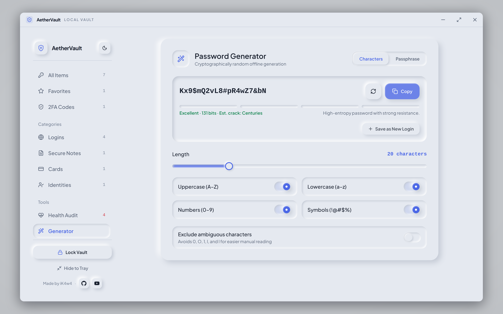

<p align="center">
  
</p>

<h1 align="center">AetherVault</h1>

<p align="center">
  A local-first, offline password manager for Windows — one portable exe, no installer.<br>
  A Rust vault engine (Argon2id + XChaCha20-Poly1305) under a neumorphic WebView2 interface.<br>
  No account, no cloud, no network, no telemetry. Your vault file (<code>vault.dat</code>)<br>
  lives next to the exe and never leaves your machine.
</p>

<p align="center">
  <a href="https://github.com/iK4w4/AetherVault/releases"></a>
  
  
  
  
</p>

<p align="center">
  <a href="https://www.youtube.com/@iK4w4"></a>
  <a href="https://t.me/iK4w4"></a>
  <a href="https://t.me/AskKawaBot"></a>
</p>

## Screenshots


*Your vault — entries, TOTP codes, and details in one place.*


*Password generator with entropy and crack-time estimate.*


*Health audit — vault score, weak, reused, and aging passwords.*

## Download

Grab `AetherVault.exe` from the
[latest release](https://github.com/iK4w4/AetherVault/releases/latest)
— one file, no installer, just run it. (The source archives listed
under each release are generated by GitHub from this repository.)

> **Scope:** AetherVault is a young, one-person project. There is
> no cloud copy and no password reset — if you lose both your
> master password and your recovery key, the vault cannot be
> opened. Back up `vault.dat` and write the recovery key down
> somewhere safe.

## Features

- **Strong encryption** — Argon2id key derivation (64 MiB, 3
  iterations, parallelism 4) and XChaCha20-Poly1305 authenticated
  encryption, with a fresh nonce per write. The master key is
  wrapped separately under the master password and the recovery
  key, and is zeroized from memory on lock.
- **Unlock protection** — failed unlocks are counted and
  persisted; five failures trigger a lockout with exponential
  backoff.
- **TOTP 2FA** — RFC 6238 authenticator codes (SHA-1 / SHA-256 /
  SHA-512), computed in Rust.
- **Password generator** — cryptographically random passwords and
  passphrases, generated fully offline.
- **Health audit** — finds weak, reused, and duplicate passwords
  across the vault.
- **Clipboard auto-clear** — copied secrets self-clear after a
  configurable delay, and only if the clipboard still holds that
  exact secret.
- **System tray** — hide to the tray, lock from the tray menu,
  restore with a click.
- **Neumorphic UI** — a tactile, custom interface: no browser
  chrome, custom right-click menu, custom switches, sliders, and
  dropdowns.
- **Portable** — a single exe, no installer, no admin rights.
  Atomic saves with a backup copy protect the vault against
  interrupted writes.

## Usage

1. Double-click `AetherVault.exe`.
2. On first run, create a master password. The recovery key is
   shown exactly once — write it down somewhere safe. It is the
   only way back in if the master password is forgotten.
3. Your vault file (`vault.dat`) lives next to the exe. Keep the
   exe in a folder you can write to (Desktop, Documents, USB
   stick), and back up `vault.dat`.
4. Closing the window quits the app. **Hide to Tray** in the
   sidebar sends it to the system tray instead: right-click the
   tray icon for Show / Lock Vault / Quit.

## Build from source

Prerequisites:

- Node.js 20+ and npm
- Rust (stable, via rustup)
- Windows: the MSVC build tools — or cross-build from Linux with
  cargo-xwin (see [BUILD.txt](BUILD.txt))

```sh
npm install
npm run tauri dev      # run in development mode
npm run tauri build    # production build -> src-tauri/target/release/aethervault.exe
```

## Security model

- Everything is encrypted locally with Argon2id +
  XChaCha20-Poly1305.
- The app makes zero network requests. Fonts are bundled.
  Nothing leaves the machine.
- The frontend runs in WebView2 and necessarily sees entry
  plaintext while the vault is unlocked (it has to render it).
  Keys never leave Rust memory. Only run builds from this
  repository.

See [SECURITY.md](SECURITY.md) for how to report a vulnerability
and how to verify a release download.

## Feedback

Open an issue here, or reach me on Telegram: [@AskKawaBot](https://t.me/AskKawaBot).

## Credits

Created by **iK4w4**

- GitHub: https://github.com/iK4w4
- YouTube: https://www.youtube.com/@iK4w4
- Third-party fonts and libraries: see [THIRD-PARTY.md](THIRD-PARTY.md)

## License

MIT — see [LICENSE](LICENSE). The license covers this
repository's own files; bundled third-party components keep
their own licenses (see [THIRD-PARTY.md](THIRD-PARTY.md)).
