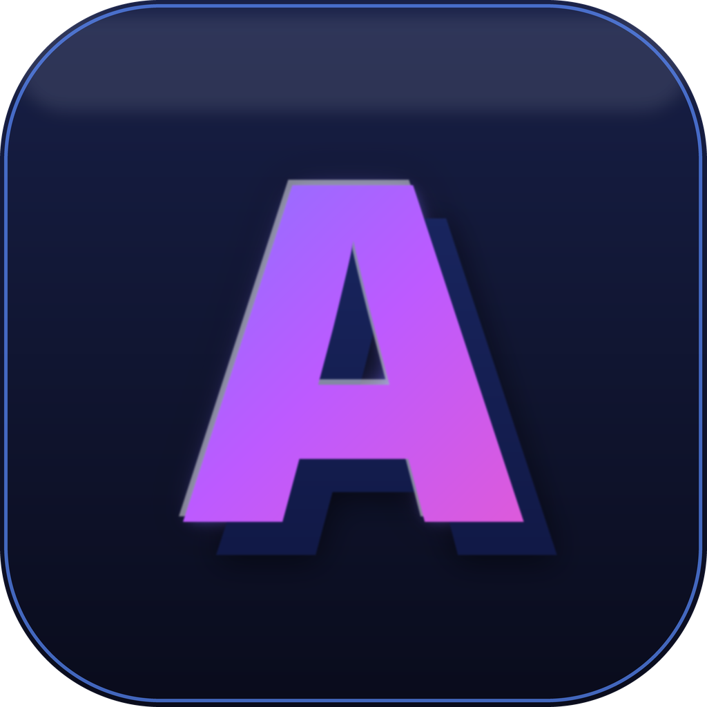
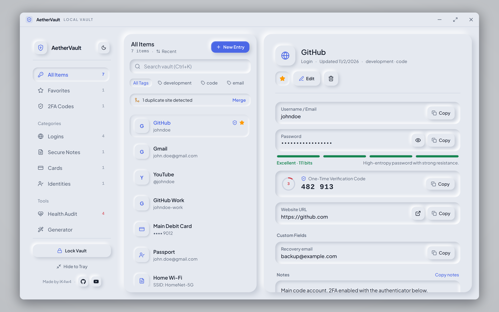
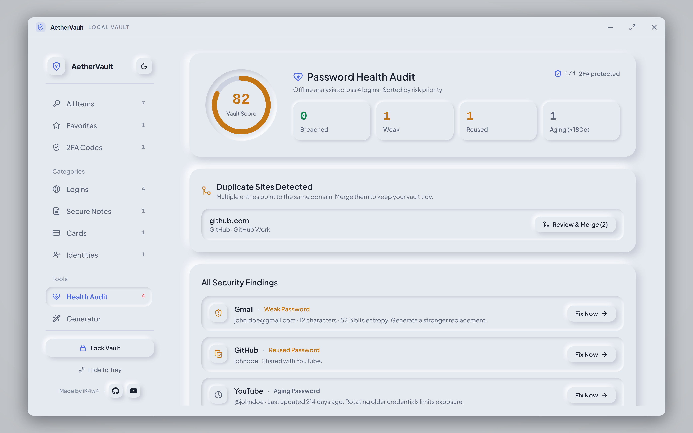

<p align="center">
  
</p>

<h1 align="center">AetherVault</h1>

<p align="center">
  A local-first, offline password manager for Windows — one portable exe, no installer.<br>
  No account, no cloud, no telemetry. Your vault never leaves your machine.
</p>

<p align="center">
  <a href="https://github.com/iK4w4/AetherVault/releases/latest"></a>
  
  
  
  
</p>

<p align="center">
  <a href="https://www.youtube.com/@iK4w4"></a>
  <a href="https://t.me/iK4w4"></a>
  <a href="https://t.me/AskKawaBot"></a>
</p>

## Screenshots


*Your vault — entries, TOTP codes, and details in one place.*


*Password generator with entropy and crack-time estimate.*


*Health audit — vault score, weak, reused, and aging passwords.*

## Download

Get `AetherVault.exe` from the
[latest release](https://github.com/iK4w4/AetherVault/releases/latest)
and run it. One file, no installer, no admin rights.

> There is no cloud copy and no password reset. If you lose both
> your master password and your recovery key, the vault cannot be
> opened — back up `vault.dat` and keep the recovery key somewhere
> safe.

## Features

| | |
|---|---|
| **Encryption** | Argon2id (64 MiB, 3 rounds) + XChaCha20-Poly1305, fresh nonce on every write |
| **Unlock protection** | Failed attempts are counted — 5 failures trigger a lockout that grows each time |
| **TOTP codes** | Authenticator codes (6, 7, or 8 digits), computed in Rust |
| **Generator** | Random passwords and passphrases, made fully offline |
| **Health audit** | Finds weak, reused, and duplicate passwords across the vault |
| **Clipboard** | Copied secrets clear themselves after a delay you set |
| **Imports** | Bitwarden, 1Password, and generic CSV |
| **Backups** | Encrypted backup export and import (`.aevbackup`), plus a recovery key |
| **System tray** | Hide to tray, lock, and quit from the tray menu |
| **Portable** | One exe — atomic saves with a backup copy protect against interrupted writes |

The interface is neumorphic and fully custom: no browser chrome,
custom right-click menu, switches, sliders, and dropdowns.

## How to use

1. Run `AetherVault.exe`.
2. Create a master password. The recovery key is shown once —
   write it down somewhere safe.
3. Your vault file (`vault.dat`) lives next to the exe. Keep the
   exe in a folder you can write to, and back up `vault.dat`.
4. Closing the window quits the app. **Hide to Tray** in the
   sidebar keeps it in the system tray instead.

## Security

- Everything is encrypted on your machine. Keys stay in Rust
  memory and are zeroized when the vault locks.
- The app makes zero network requests. Fonts are bundled,
  nothing is sent anywhere.
- The frontend (WebView2) sees entry text only while the vault
  is unlocked, so it can show it to you. Only run builds from
  this repository.

See [SECURITY.md](SECURITY.md) for reporting a vulnerability and
verifying a download.

## Build from source

You need Node.js 20+, Rust (stable), and the MSVC build tools —
or cross-build from Linux with cargo-xwin (see [BUILD.txt](BUILD.txt)).

```sh
npm install
npm run tauri dev      # run in development mode
npm run tauri build    # production build -> src-tauri/target/release/aethervault.exe
```

## Credits

Created by **iK4w4** —
[GitHub](https://github.com/iK4w4) ·
[YouTube](https://www.youtube.com/@iK4w4) ·
Telegram [@AskKawaBot](https://t.me/AskKawaBot)

Third-party fonts and libraries: see [THIRD-PARTY.md](THIRD-PARTY.md).

## License

MIT — see [LICENSE](LICENSE). Bundled third-party components keep
their own licenses.
